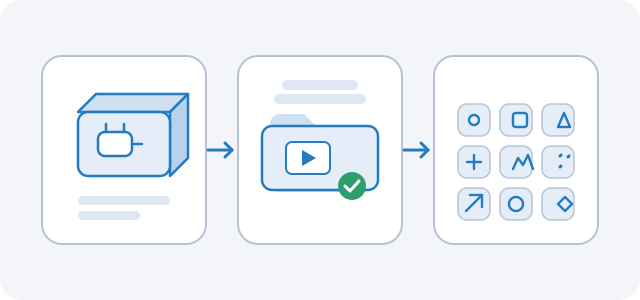

# dsh-labview-mcp

**English** · [简体中文](README.zh-CN.md)

[](packages/dsh-labview-mcp/LICENSE)
[](#requirements)
[](#installation)

An **unofficial** DSH bundle for [Zuehlke's LabVIEW MCP server](https://github.com/Zuehlke/labview-mcp).
Install it once from **Plugins** and every new DSH session has the `mcp__labview__*`
tools — no manual MCP setup, no profile editing, no build step.



> [!NOTE]
> This project is not affiliated with, or endorsed by, National Instruments or Zuehlke.

## Highlights

- **123 `mcp__labview__*` tools** in every new session, served by the bundled
  LabVIEW MCP runtime.
- **Two native diagnostics.** `labview_mcp_status` is a read-only health report;
  `labview_mcp_repair` re-runs provisioning in place.
- **Runtime status in Plugins.** The plugin's own page carries a state tag and a
  **Runtime** card — binary package, tools directory, tool count, last error — with
  **Refresh** and **Repair** buttons, so the first question after an install is
  answered without opening a session.
- **A versioned, local runtime.** The runtime is copied to
  `%USERPROFILE%\.dsh\tools\labview-mcp\<binary-version>\`; the two newest versions
  are kept, and the executable never runs from `node_modules`.
- **LabVIEW is optional.** The `pylv_*` tools work without LabVIEW installed; the
  `lvai_*` tools need LabVIEW's AI gRPC service.
- **Nothing to compile.** No install scripts, no build step; the only dependency is the
  platform runtime package, installed with the plugin.

## Requirements

| Requirement | Detail |
| --- | --- |
| **DSH** | A build that has the **Plugins** page and supports plugin bundles. |
| **Windows x64** | Required. The runtime package is a required dependency, so installation is refused on other platforms. |
| **LabVIEW** | Optional — see above. |
| **Disk** | ~57 MB for the `dsh-labview-mcp-win32-x64` package, plus ~178 MB of provisioned runtime. |
| **Tokens** | 65–75k per request: all 123 tool definitions are sent to the model. Disable the plugin when you are not using it. |

## Installation

1. Open **Plugins** in DSH.
2. Choose **Add plugin**.
3. Enter `dsh-labview-mcp` and confirm.

DSH downloads the platform package during installation. On first start the plugin
provisions the runtime in the background, then registers the `labview` MCP server;
new sessions then see the `mcp__labview__*` tools. The first launch of the unsigned
`LabVIEWMCP.exe` can be slow while Windows scans it — the plugin allows 120 seconds.

If the install fails because the registry cannot resolve `dsh-labview-mcp-win32-x64@3.1.9`,
the registry is a mirror that has not synced the 57 MB package yet. Install again with
`registry.npmjs.org`, or wait for the mirror and reinstall; a mirror that lacks the package
can never produce a working plugin.

## Usage

| Tool | What it does |
| --- | --- |
| `labview_mcp_status` | Read-only report: state, platform, runtime and server versions, tool count, tools directory, last error. |
| `labview_mcp_repair` | Re-runs provisioning and restarts the registration; `{ "force": true }` recopies an intact but suspected-bad runtime. |

Configuration (`toolCallTimeoutMs`), the state table, troubleshooting, disable and
uninstall, and upgrading from v1 live in the
[plugin manual](packages/dsh-labview-mcp/README.md).

## Repository layout

```text
.
├── packages/dsh-labview-mcp/   the plugin: Host half, browser half, Fetch routes, locales, tests
│   ├── docs/                   design detail, migration notes, preview image
│   └── test/                   node --test suites
├── scripts/                    release and binary-package builders, fresh-install check (maintainers)
├── docs/
│   ├── adr/                    architecture decision records
│   └── agents/                 how this repository is worked on
└── .scratch/                   issue tracker: one folder per feature
```

## Development

```bash
pnpm install     # pnpm 11
pnpm test        # node --test — 88 tests
```

## Documentation

- [Plugin manual](packages/dsh-labview-mcp/README.md) — install, configure, troubleshoot, uninstall
- [Design detail](packages/dsh-labview-mcp/docs/DETAIL.md) · [中文](packages/dsh-labview-mcp/docs/DETAIL.zh.md)
- [Upgrading from v1](docs/migration-v1-to-v2.md)
- [Architecture decision records](docs/adr/)

## Contributing

Pull requests are welcome. Issues and specs are kept in this repository as markdown
under `.scratch/<feature>/` — see the [issue tracker note](docs/agents/issue-tracker.md).
For anything larger than a typo fix, please open an issue there first.

## License

MIT — see [LICENSE](packages/dsh-labview-mcp/LICENSE). The bundled runtime keeps its
own licenses: [Zuehlke's LabVIEW MCP](packages/dsh-labview-mcp/LICENSE-Zuehlke.txt) and
[pylabview](packages/dsh-labview-mcp/LICENSE-pylabview.txt); see
[THIRD-PARTY-NOTICES.md](packages/dsh-labview-mcp/THIRD-PARTY-NOTICES.md).
