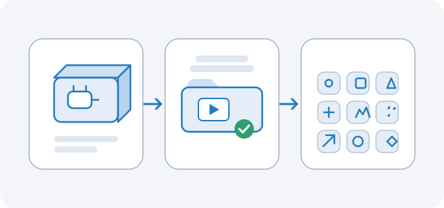

# dsh-labview-mcp

[English](README.md) · **简体中文**

[](packages/dsh-labview-mcp/LICENSE)
[](#环境要求)
[](#安装)

把 [Zuehlke 的 LabVIEW MCP 服务器](https://github.com/Zuehlke/labview-mcp)接进 DSH 的**非官方**插件包。
在 **Plugins** 里装一次，之后每个新会话都带着 `mcp__labview__*` 工具 —— 不用手工配 MCP，
不用改 profile，也没有构建步骤。



> [!NOTE]
> 本项目与 National Instruments、Zuehlke 均无隶属关系，也未获其背书。

## 特性

- **122 个 `mcp__labview__*` 工具**，每个新会话都可见，全部由随包供给的 LabVIEW MCP 运行树提供。
- **两个原生诊断工具**：`labview_mcp_status` 是只读健康报告，`labview_mcp_repair` 就地重跑供给。
- **插件页内的运行状态**：插件自己的页面带着状态标签和一张 **Runtime** 卡片 —— 二进制包、
  工具目录、工具数量、最近一次错误 —— 配 **Refresh** 与 **Repair** 按钮，装完后的第一个问题
  不必开会话就能回答。
- **本地版本化运行树**：运行树被复制到
  `%USERPROFILE%\.dsh\tools\labview-mcp\<binary-version>\`，只保留最新两个版本，
  可执行文件永远不从 `node_modules` 里运行。
- **LabVIEW 可选**：`pylv_*` 系列工具不装 LabVIEW 也能用；`lvai_*` 系列需要 LabVIEW 的 AI gRPC 服务。
- **没有东西要编译**：无安装脚本、无构建步骤；唯一的依赖是随插件一起安装的平台运行包。

## 环境要求

| 项目 | 说明 |
| --- | --- |
| **DSH** | 带有 **Plugins** 页面、支持插件包的版本。 |
| **Windows x64** | 必须。平台运行包是必需依赖，其他平台上安装会被拒绝。 |
| **LabVIEW** | 可选 —— 见上。 |
| **磁盘** | `dsh-labview-mcp-win32-x64` 包约 57 MB，另加约 178 MB 已供给的运行树。 |
| **Token** | 每次请求 65–75k：122 个工具定义会全部发给模型。不用时把插件禁用掉。 |

## 安装

1. 打开 DSH 的 **Plugins**。
2. 点 **Add plugin**。
3. 输入 `dsh-labview-mcp` 并确认。

DSH 会在安装时下载平台二进制包。首次启动时插件在后台完成供给，然后注册 `labview` MCP 服务器；
新会话随即能看到 `mcp__labview__*` 工具。未签名的 `LabVIEWMCP.exe` 首次启动可能因 Windows
扫描而变慢 —— 插件给它 120 秒启动时间。

如果安装时 registry 解析不到 `dsh-labview-mcp-win32-x64@3.1.0`，说明该 registry 是镜像且尚未同步
57 MB 的平台包。请改用 `registry.npmjs.org` 重装，或等镜像同步后重装；缺少平台包的镜像永远装不出可用插件。

## 使用

| 工具 | 作用 |
| --- | --- |
| `labview_mcp_status` | 只读报告：状态、平台、运行树与服务器版本、工具数量、工具目录、最近一次错误。 |
| `labview_mcp_repair` | 重跑供给并重启注册；传 `{ "force": true }` 可强制重拷一份看似完整但疑似损坏的运行树。 |

配置项（`toolCallTimeoutMs`）、状态表、故障排查、禁用与卸载、从 v1 升级，都在
[插件手册](packages/dsh-labview-mcp/README.md)里。

## 仓库结构

```text
.
├── packages/dsh-labview-mcp/   插件本体：Host 半边、浏览器半边、Fetch 路由、语言包、测试
│   ├── docs/                   设计细节、迁移说明、示意图
│   └── test/                   node --test 测试
├── scripts/                    发布与二进制包构建脚本（维护者用）
├── docs/
│   ├── adr/                    架构决策记录
│   └── agents/                 这个仓库怎么协作
└── .scratch/                   issue tracker：一个功能一个目录
```

## 开发

```bash
pnpm install     # pnpm 11
pnpm test        # node --test —— 83 个用例
```

## 文档

- [插件手册](packages/dsh-labview-mcp/README.md) —— 安装、配置、排查、卸载
- [设计细节](packages/dsh-labview-mcp/docs/DETAIL.zh.md) · [English](packages/dsh-labview-mcp/docs/DETAIL.md)
- [从 v1 升级](docs/migration-v1-to-v2.md)
- [架构决策记录](docs/adr/)

## 参与贡献

欢迎 PR。issue 与 spec 以 markdown 形式存放在本仓库的 `.scratch/<feature>/` 下 ——
见 [issue tracker 说明](docs/agents/issue-tracker.md)。改动大于改错别字的话，请先在那里开一个 issue。

## 许可

MIT —— 见 [LICENSE](packages/dsh-labview-mcp/LICENSE)。随包运行树保留它自己的许可：
[Zuehlke 的 LabVIEW MCP](packages/dsh-labview-mcp/LICENSE-Zuehlke.txt) 与
[pylabview](packages/dsh-labview-mcp/LICENSE-pylabview.txt)，详见
[THIRD-PARTY-NOTICES.md](packages/dsh-labview-mcp/THIRD-PARTY-NOTICES.md)。
